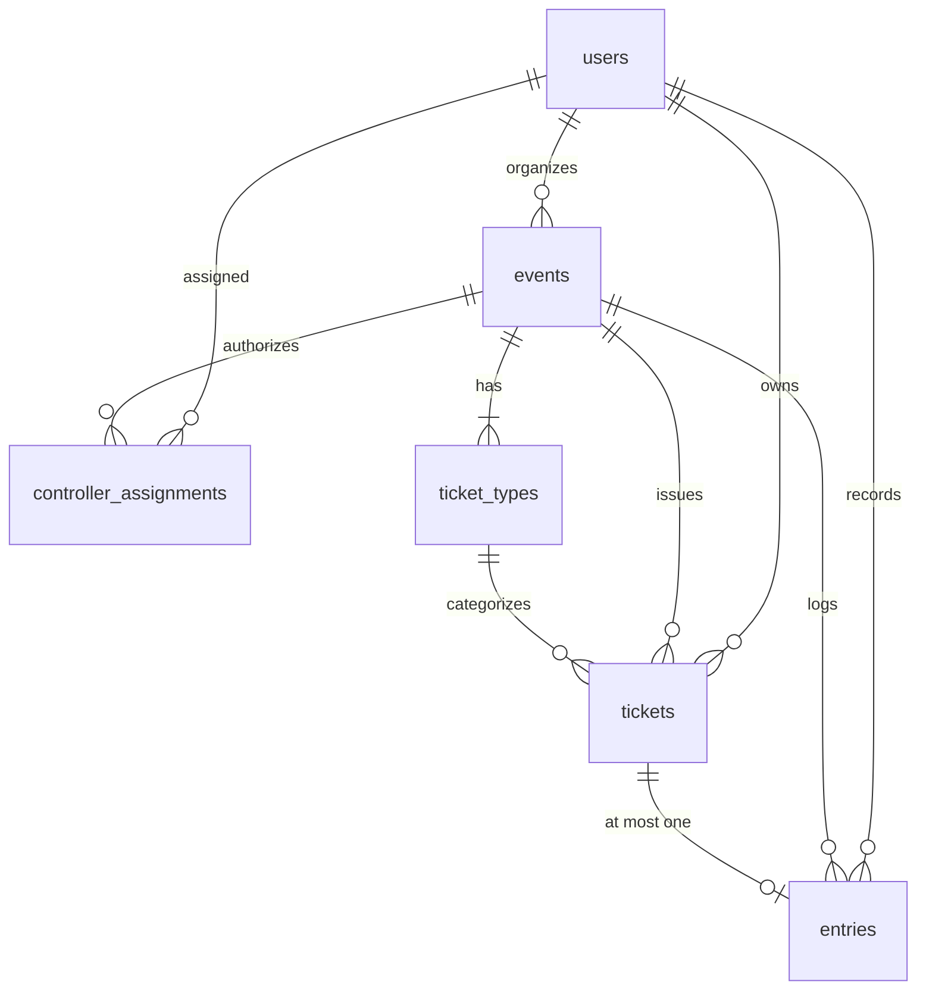

# Database Schema & Invariants — EventFlow Practice 05

PostgreSQL 16 (`backend/db/migrations/001_init.sql`). All timestamps are stored in UTC (`TIMESTAMPTZ`). Server time (`NOW()`) is authoritative.

## ER Diagram

## Tables

| Table | Purpose | Key Constraints |
|---|---|---|
| `users` | Accounts for `participant`, `organizer`, `controller` | `email UNIQUE`, `role CHECK IN ('participant','organizer','controller')` |
| `events` | Event definitions, capacity, and UTC windows | `capacity > 0`, `chk_event_dates` (`starts_at < ends_at`, `admission_opens_at < admission_closes_at`, `registration_closes_at <= starts_at`, `admission_opens_at <= starts_at`, `admission_closes_at >= starts_at`) |
| `ticket_types` | Categories per event (minimum 2: e.g. `Стандарт`, `VIP`) | `capacity > 0`, `UNIQUE(event_id, name)` |
| `tickets` | Issued/used/cancelled tickets with SHA-256 `token_hash` & Fernet `token_encrypted` | `code UNIQUE`, `token_hash UNIQUE`, partial unique index `uq_active_ticket_per_user_event` on `(event_id, participant_id) WHERE status IN ('ISSUED','USED')` |
| `controller_assignments` | Which controllers are authorized for which events | `UNIQUE(event_id, controller_id)` |
| `entries` | Successful check-in records only | `ticket_id UNIQUE` (DB-level double-entry guarantee) |
| `registration_requests` | Idempotency store for ticket registration | `UNIQUE(participant_id, request_id)` |
| `checkin_requests` | Idempotency store for check-in scans | `UNIQUE(controller_id, request_id)` |
| `audit_logs` | Server-timestamped audit trail (never stores raw QR tokens) | `server_time TIMESTAMPTZ` |

## Invariants: DB vs Transaction

- **Enforced by PostgreSQL constraints/indexes:**
  - At most one active (`ISSUED` or `USED`) ticket per `(event_id, participant_id)` (`uq_active_ticket_per_user_event`).
  - At most one `entries` row per `ticket_id` (`UNIQUE(ticket_id)`).
  - Valid date ordering (`chk_event_dates`) and positive capacities (`capacity > 0`).
  - Idempotency key uniqueness (`registration_requests`, `checkin_requests`).
- **Enforced by server-side `SELECT ... FOR UPDATE` transactions:**
  - Deterministic lock ordering (`events` → `ticket_types` / `tickets`) prevents deadlocks.
  - Atomic last-seat check (`event_occupied < event.capacity` and `type_occupied < ticket_type.capacity`).
  - Atomic `ISSUED → USED` vs `ISSUED → CANCELLED` race resolution.
  - Sum of `ticket_types.capacity == events.capacity` on create/update/publish.
  - Controller assignment & event ownership verification on every request.
